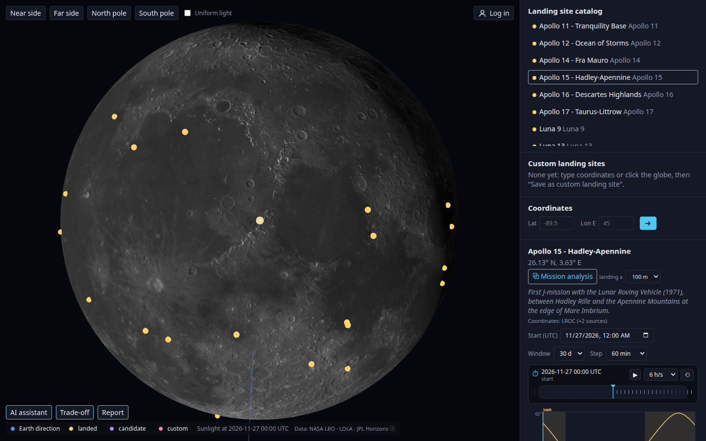
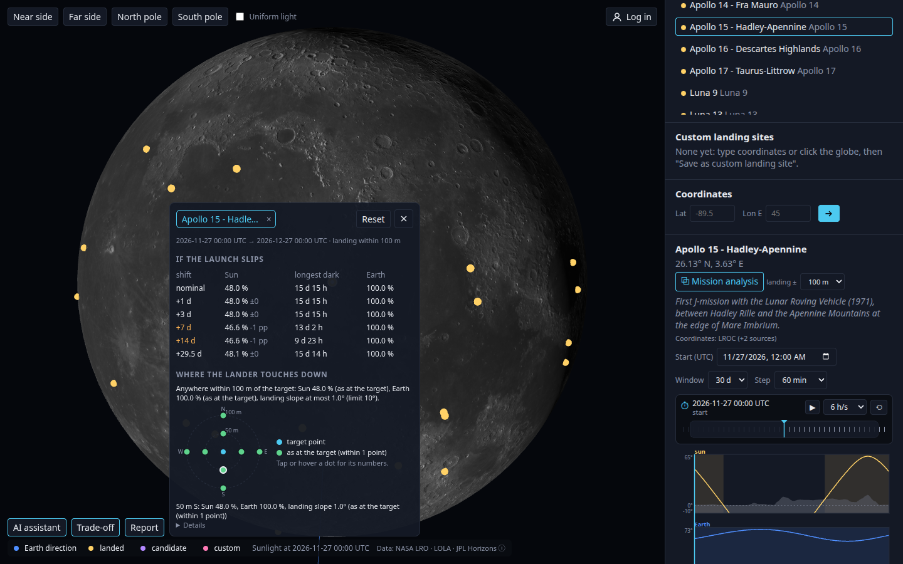
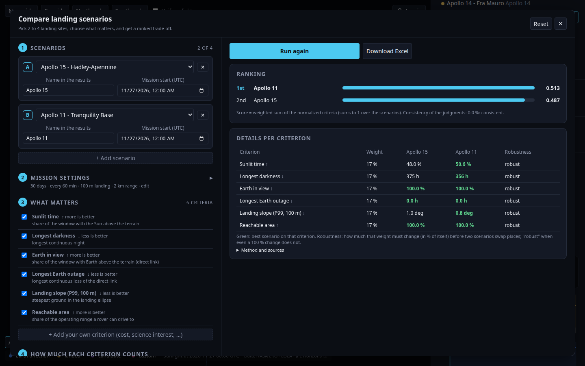
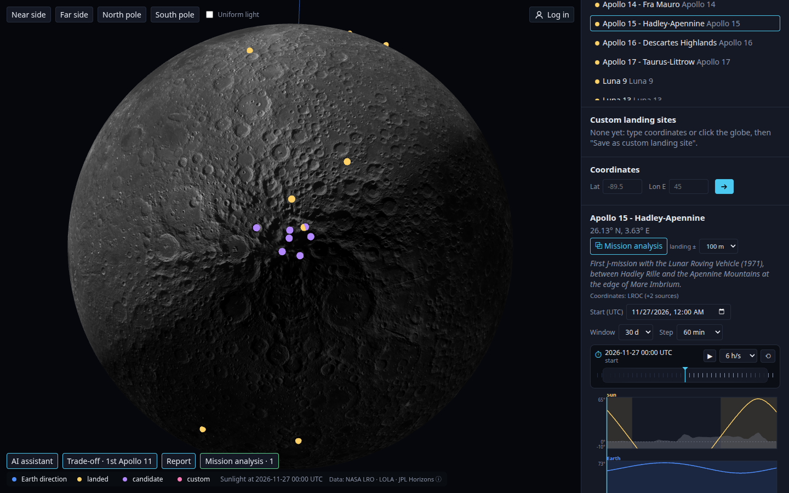
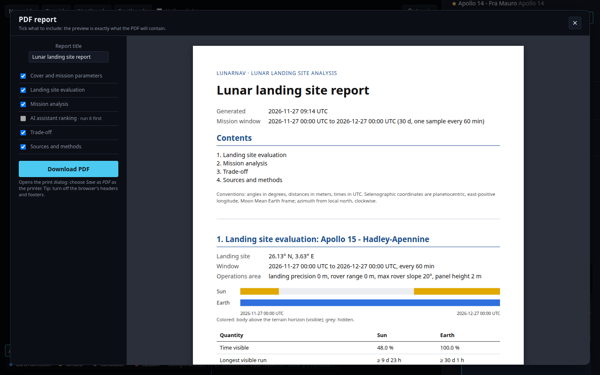
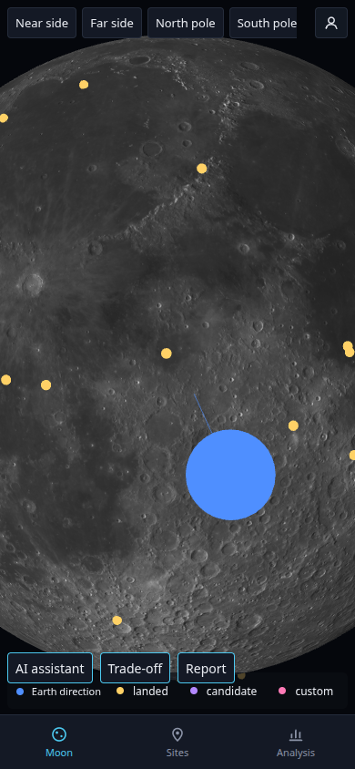
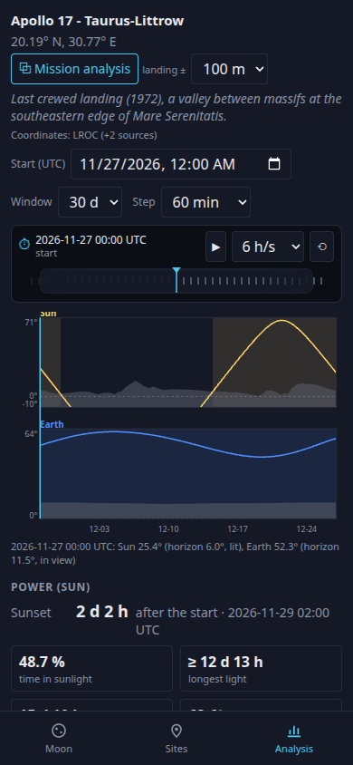

<!-- ABOUTME: Front page of the LunarNav repo: the live site, what it does, how it works, screenshots -->
<!-- ABOUTME: Owner: Gian. Setup and run instructions live in docs/DEVELOPMENT.md -->

# LunarNav

**Where on the Moon can a lander stay powered and keep talking to Earth?**

LunarNav is a lunar landing site navigator built by team **Purapura** for the
[NASA Space Apps Challenge 2026](https://www.spaceappschallenge.org/2026/challenges/lunar-landing-site-navigator/?tab=details).
Pick any point on the Moon and a time window: LunarNav tells you when the Sun and the Earth are
above the *real* terrain horizon there, how long the nights and the radio outages last, how flat
the ground is, and how robust all of that is to a late launch or an imprecise landing.

### 🌕 Try it: **[lunarnav.tailebb034.ts.net](https://lunarnav.tailebb034.ts.net)**

It runs in the browser on desktop and phone; no installation, no account needed. If the site is
down, the [screenshots](#screenshots) below show what it does.

## What you can do

- **Explore the Moon in 3D.** The globe uses NASA's LRO mosaic and is lit by the real Sun
  direction at the chosen date; the day/night terminator moves as you scrub through time. The
  catalog holds 36 historic and planned landing sites (Apollo, Luna, Surveyor, Chang'e,
  Chandrayaan, SLIM, CLPS, Artemis candidates).
- **Evaluate any site or point.** Click a marker, click anywhere, or type coordinates. For the
  chosen window you get the Sun and Earth elevation against the local horizon, the share of time in
  sunlight and with a direct link to Earth, the longest night and the longest outage, the next
  sunset or earthset, and the landing slope.
- **Stress-test a landing: Mission analysis.** How do sunlight, darkness and Earth visibility
  change if the launch slips by days, and across the points where the lander may actually touch
  down within its landing precision? A target diagram shows where not to land.
- **Compare sites: Trade-off.** Put 2 to 4 sites side by side, choose what matters (sunlight,
  darkness, Earth contact, slope, reachable area, your own criteria), weight them equally, by
  pairwise comparison (AHP) or by hand, and get a ranking with a sensitivity check. Download it as
  a live Excel workbook.
- **Ask the AI assistant.** Describe a mission in plain words ("two-week robotic lander near the
  south pole") and get the catalog ranked against it. The AI only reads your request; every
  number comes from the engine and is checked before it is shown. It runs on your own Anthropic
  API key, which stays in your browser.
- **Export a PDF report** with the sections you choose: site evaluation, mission analysis, AI
  ranking, trade-off, sources and methods.
- **Save your sites.** Without an account they last for your browser session; with a free account
  they are kept and follow you across devices. You can also **propose** a site for the shared
  catalog: approved ones appear for everyone.

## How it works

| Piece | What it does | Source |
|---|---|---|
| Terrain | Horizon masks from 150 km rays and slopes over the landing area | NASA LRO LOLA elevation models: global 474 m grid, south polar 80 m and 20 m grids ([PDS](https://pds-geosciences.wustl.edu/lro/lro-l-lola-3-rdr-v1/lrolol_1xxx/data/lola_gdr/)) |
| Sun and Earth | Their direction from the site at every time step of the window | [JPL Horizons](https://ssd.jpl.nasa.gov/horizons/), cached |
| Evaluation | A body counts as visible when its center is above the terrain horizon at its azimuth; runs, fractions and next events from the time series | Our engine (Python) |
| Robustness | The same evaluation over launch slips and dispersed touchdown points | Our engine |
| Trade-off | Normalized criteria, AHP weights (geometric mean), consistency ratio, sensitivity | Saaty's AHP |
| AI assistant | Turns a request into mission requirements and explains the deterministic ranking | Claude, via the visitor's own Anthropic API key |

The frontend is React with three.js; the backend is FastAPI. Every choice and its source is in the
[decision log](docs/decisions.md), the requirements in the [spec](docs/spec.md).

## Screenshots

**Mission analysis**: launch slips and the touchdown diagram (tap or hover a dot for its numbers).

**Trade-off** between two sites, with the weight of each criterion and how robust the ranking is.

**South pole**, where the Artemis candidate sites cluster, lit by the Sun at the chosen date.

**PDF report** builder with a live A4 preview.

**On a phone**: the Moon, the site lists and the analysis are three tabs.

  
  &nbsp;
  

## Team

Team Purapura: Gian, Federico and Michael, NASA Space Apps Challenge 2026. Who did what is in
[MISSION.md](MISSION.md) and the [task files](docs/tasks/).

## Developing

Setup, checks, running it locally and the server options are in
[docs/DEVELOPMENT.md](docs/DEVELOPMENT.md).
